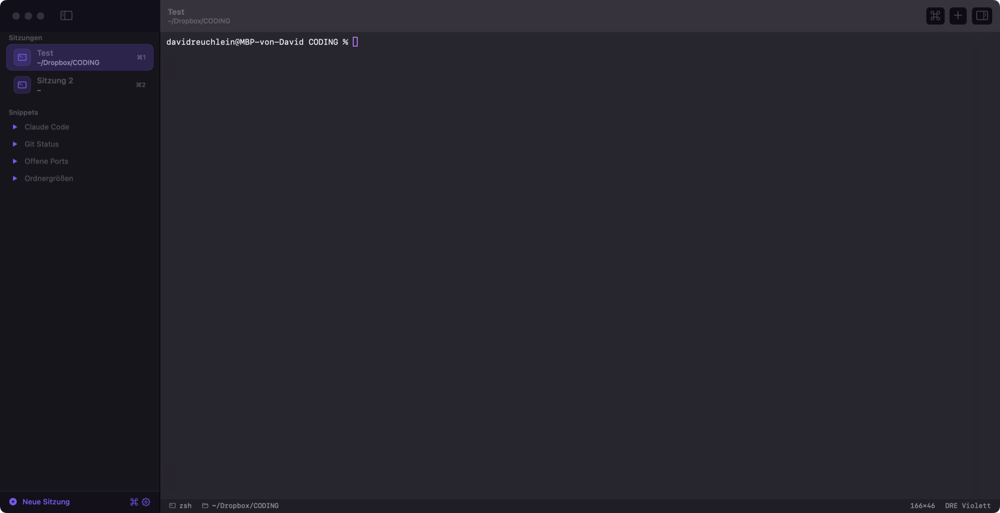

# DRETerm

[](LICENSE)


I usually have ten terminal tabs open at once: client shops, servers, a few Claude Code sessions. Every one of them was called "zsh". So I built a Mac terminal that puts the sessions in a sidebar, each with its own name, color and icon, and shows which folder it's in and what's running there.

Apart from that it behaves like Terminal.app.



## Features

| | |
|---|---|
| **Sessions** | Rename by double-click, color, icon, pin, reorder by dragging, duplicate |
| **Live status** | Current folder and foreground process (`claude`, `npm`, `ssh` …) right in the sidebar |
| **Background activity** | Dot for new output, green check when a longer command finishes, bell |
| **Restore** | Sessions survive a restart: name, color, notes and last folder. Optional one-time startup command (e.g. `claude --resume <id>`) |
| **Drag & drop** | Drop files into the terminal to paste their escaped path, drop a Finder folder on the sidebar to open a session there |
| **Command palette** | ⌘P searches sessions, snippets, themes and actions |
| **Snippets** | Saved commands, run with one click or just insert |
| **Notes** | Inspector (⌘I) with notes and details per session |
| **Look** | 6 themes, real window transparency with optional blur, any monospace font |

## How it works

- It's a real terminal: login shell, xterm-256color, truecolor. vim, htop, ssh and Claude Code work as usual.
- Folder and process come straight from the kernel (`proc_pidinfo`, `tcgetpgrp`). No shell integration, your `.zshrc` stays untouched.
- ⌥ stays ⌥ and is not used as Meta, so `@`, `[`, `]`, `|` and `{}` work on German keyboard layouts.

## Install

Requires macOS 14 and the Command Line Tools (`xcode-select --install`). Xcode is not needed.

```bash
git clone https://github.com/reuchleindavid/dreterm.git
cd dreterm
./build.sh             # builds dist/DRETerm.app
./build.sh --install   # optional: copies it to /Applications (quits a running DRETerm first)
```

The app UI is in German.

## Shortcuts

| Shortcut | Action |
|---|---|
| ⌘T | New session in the current folder |
| ⌘N | New session in the home folder |
| ⌘W | Close session |
| ⌘⇧R / double-click | Rename |
| ⌘1 … ⌘9 | Jump to session |
| ⌘⌥↑ / ⌘⌥↓ | Previous / next session |
| ⌘P | Command palette |
| ⌘I | Notes & details |
| ⌘F | Find |
| ⌘K | Clear screen |
| ⌘+ / ⌘- / ⌘0 | Font size |
| ⌘⌥+ / ⌘⌥- | More / less opaque |
| ⌘⇧O | Reveal folder in Finder |
| ⌘⇧C | Copy path |

## Good to know

- **Data:** sessions, snippets and settings live in `~/Library/Application Support/DRETerm/state.json`.
- **Running programs** don't survive an app restart. The session comes back with a fresh shell in its last folder.
- **SwiftTerm is pinned to 1.18.0.** Newer versions need Swift 6 and a newer toolchain.
- **The "DRE Violett" theme** uses the colors of [david-reuchlein.de](https://www.david-reuchlein.de/).

## Layout

```
Sources/DRETerm/
  DRETermApp.swift        App, menus, shortcuts
  Store.swift             State, persistence, one terminal view per session, process poll
  DRETerminalView.swift   Terminal view, drag & drop
  ProcInfo.swift          Folder and foreground process from the kernel
  Models.swift            Session, snippet, settings
  Theme.swift             Color schemes
  ContentView.swift       Window, terminal area, status bar
  SidebarView.swift       Session list, context menu, snippets
  PaletteView.swift       Command palette
  InspectorView.swift     Notes & details
  SettingsView.swift      Settings
Scripts/make_icon.swift   App icon from the logo
Scripts/make_banner.swift README banner
build.sh                  Bundles the .app without Xcode
```

## Planned

- Groups in the sidebar (e.g. per client)
- Split view for two sessions side by side
- macOS notification when a long command finishes
- SSH profiles with one-click connect

## License

MIT, see [LICENSE](LICENSE). Terminal engine: [SwiftTerm](https://github.com/migueldeicaza/SwiftTerm) by Miguel de Icaza (MIT).
